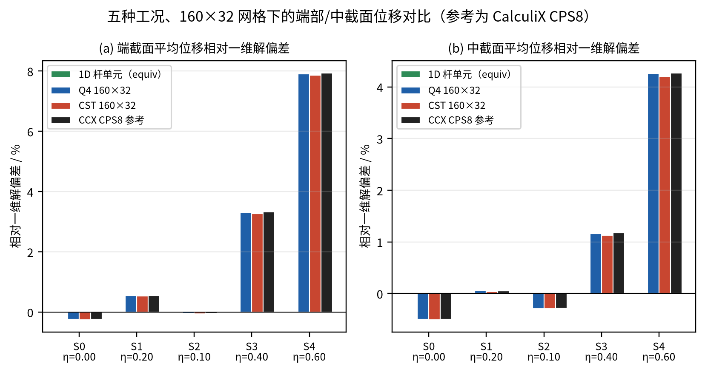
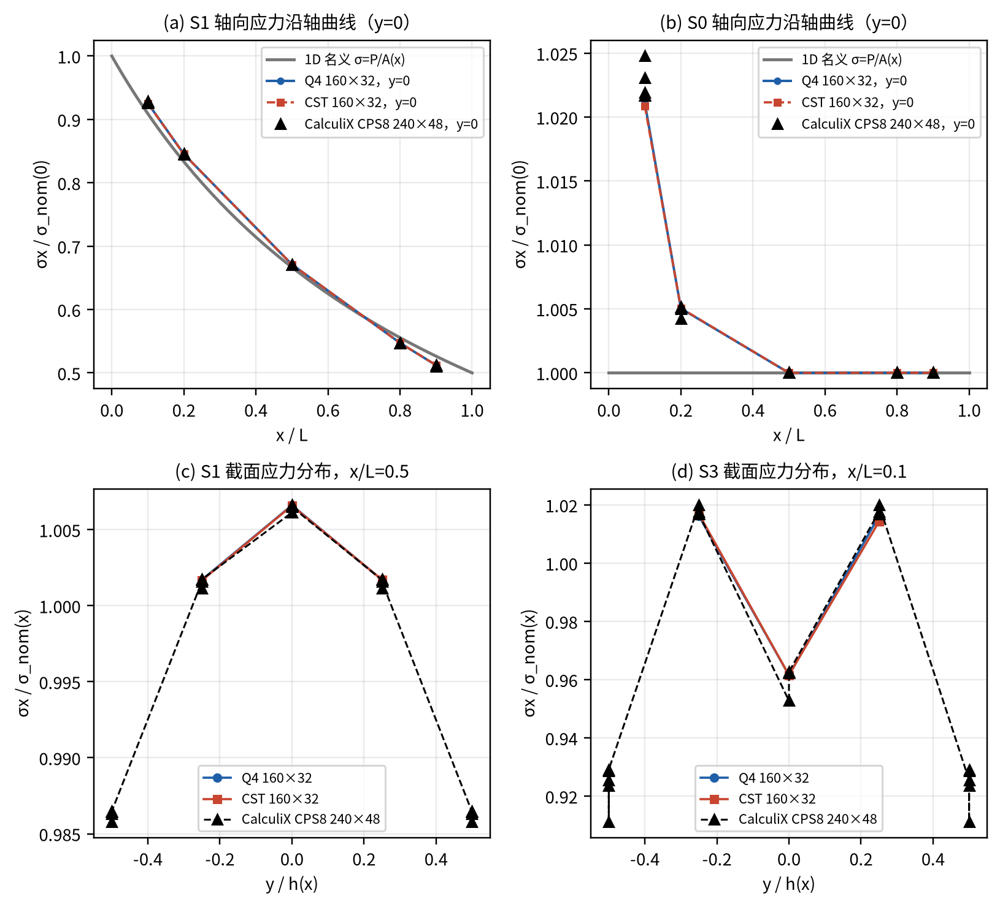
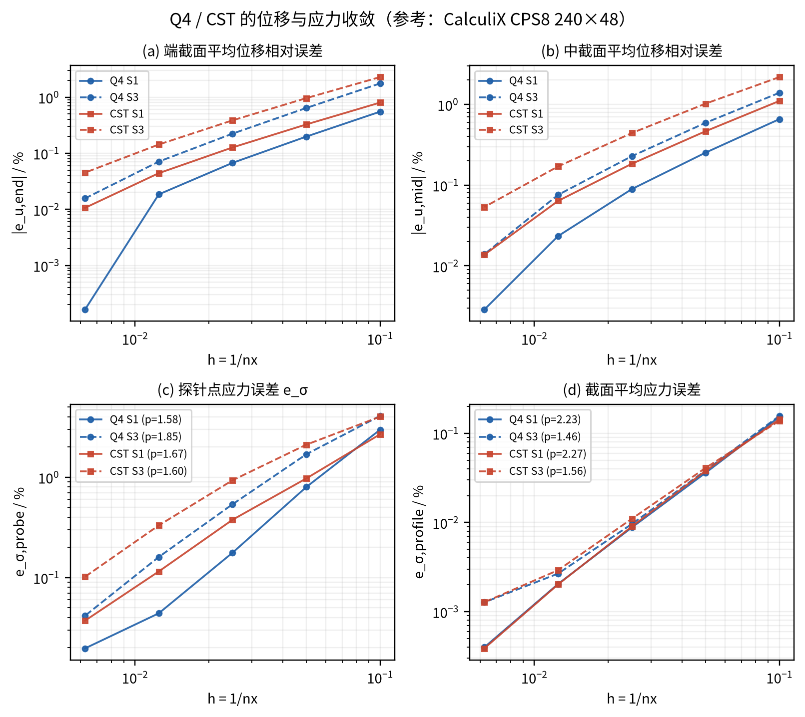
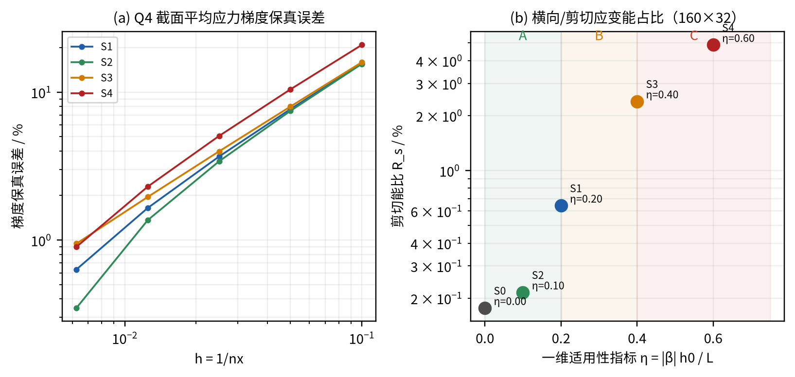
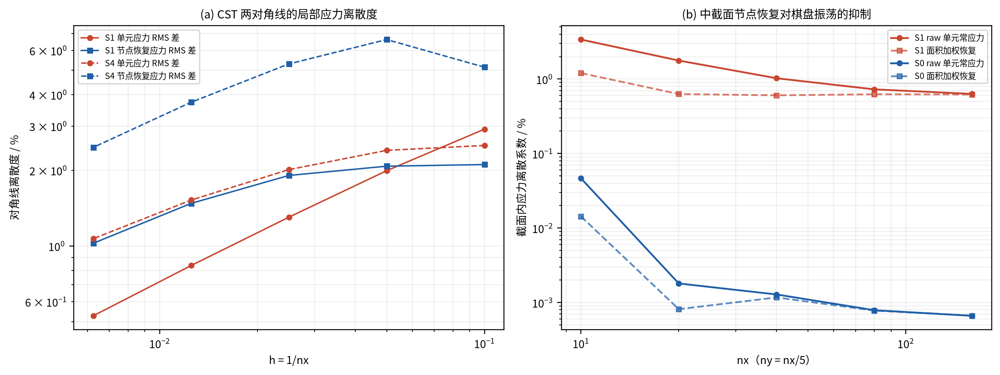
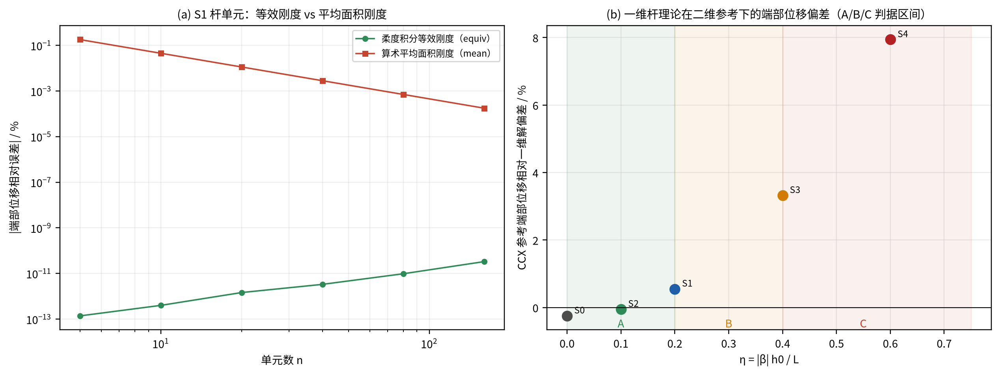
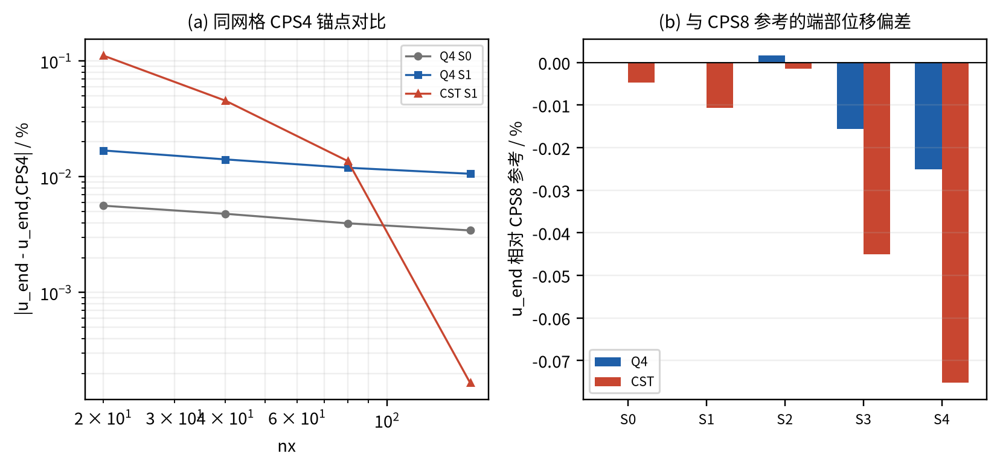
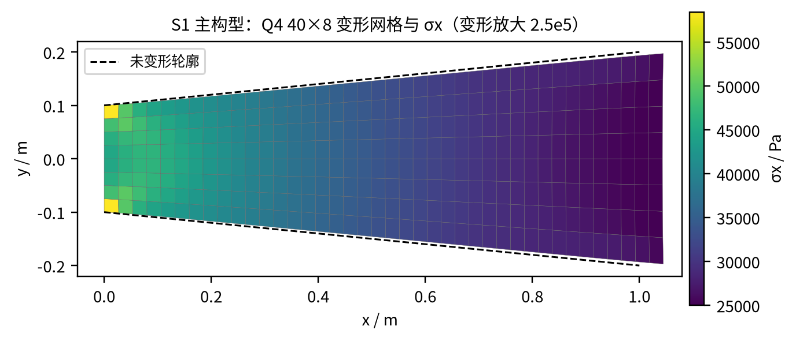

**一维变截面杆单元 / Q4 平面应力等参元 / CST 常应变三角形**

计算报告 · 2026 年 10 月 22 日

<!-- pagebreak -->
## 摘要

本文研究等截面矩形拉杆的楔形扩展问题：截面高度沿杆轴线性变化 h(x)=h0(1+βx/L)，截面关于杆轴对称，β=0 为等截面退化校核，β=+1.0 为主构型。分别采用一维变截面杆单元（柔度积分精确等效刚度）、四节点双线性等参元 Q4（2×2 高斯全积分）和三节点常应变三角形CST（显式刚度、面积加权节点应力恢复、两种对角线剖分）进行求解，并用 CalculiX 的 CPS4/CPS8 平面应力模型作为第三方锚点，FEniCS 作为可选本构校核。

在 160×32 网格上，Q4 的端/中截面平均位移相对 CalculiX CPS8（240×48）参考的最大偏差分别为 0.025% 和 0.014%；CST 对应的最大偏差为 0.075% 和 0.067%。探针点应力相对参考的最大偏差：Q4 为 0.042%，CST 为 0.146%；Q4 的梯度保真误差为 0.95%，观测收敛阶约 1.0–1.7。CST 的两种对角线剖分在对称工况下互为镜像，端/中位移与截面平均应力是严格不变量（离散度约 1e-11%）；局部单元应力的对角线离散度在 160×32 下为 0.2%–1.1%，说明对角线敏感性只体现在局部场，而不在全局位移上。

一维杆判据采用 η=|β|h0/L=tan(锥角)：S0/S1/S2 判为 A（可信），S3 判为 B（需二维复核），S4 判为 C（不可信）。与 CalculiX 参考相比，一维杆的端部位移偏差依次为 0.25%、-0.55%、0.05%、-3.21%、-7.36%；中截面偏差依次为 0.50%、-0.05%、0.29%、-1.16%、-4.10%。（偏差定义为 (一维杆 − CCX 参考)/CCX 参考。）

**关键词**：变截面杆；平面应力；Q4；CST；等效刚度；收敛性；CalculiX；对角线敏感性

<!-- pagebreak -->
## 1 问题定义与研究内容

### 1.1 研究对象

杆轴沿 x 轴，x∈[0,L]。矩形截面的面外宽度（厚度）b 恒定，面内高度线性变化：

EQUATION:h(x) = h0 (1 + β x / L),   β = (h1 − h0) / h0

截面关于杆轴对称：y∈[−h(x)/2, +h(x)/2]。这样截面形心线为直线 y=0，端部均布轴力的合力通过形心线，不引入“平底楔形”会产生的附加整体弯曲。β=0 退化为等截面矩形杆。

表 1 几何与材料参数

| 参数 | 符号 | 取值 | 单位 |
|---|---|---|---|
| 杆长 | L | 1.0 | m |
| 固定端高度 | h0 | 0.2 | m |
| 面外厚度 | b | 0.1 | m |
| 弹性模量 | E | 2.0e11 | Pa |
| 泊松比 | ν | 0.3 | — |
| 端部总拉力 | P | 1000 | N |
| 平面应力厚度 | t=b | 0.1 | m |

### 1.2 计算工况

主构型 S1 取 β=+1.0（h 由 0.2 m 增至 0.4 m），S0 为 β=0 的退化校核；另设收缩楔形 S2、粗短强楔形 S3 和极端楔形 S4，用于标定一维适用性判据的 A/B/C 边界。

表 2 五种计算工况

| 工况 | β | h0 / m | h1 / m | η=|β|h0/L | 锥角 / ° | A1/A0 |
|---|---|---|---|---|---|---|
| S0 | +0.00 | 0.20 | 0.20 | 0.00 | 0.0 | 1.00 |
| S1 | +1.00 | 0.20 | 0.40 | 0.20 | 11.3 | 2.00 |
| S2 | -0.50 | 0.20 | 0.10 | 0.10 | 5.7 | 0.50 |
| S3 | +1.00 | 0.40 | 0.80 | 0.40 | 21.8 | 2.00 |
| S4 | +2.00 | 0.30 | 0.90 | 0.60 | 31.0 | 3.00 |

### 1.3 边界条件与载荷

- 固定端 x=0：该端全部节点 ux=uy=0。
- 加载端 x=L：沿 x 方向施加均布轴向拉力，合力 P=1000 N；采用**一致节点载荷**（线性边每段载荷一半分给两端节点，角点为内点的一半；CPS8 用 1/6–2/3–1/6 分配）。
- 上下斜边：自由（无面力）。

NOTE: 旧版程序与部分对比算例曾采用“每个端节点等分 P”的集中载荷。两者对 u_end 的影响 ≤0.281%，对加载端局部应力可达 1%–8%。本报告统一采用一致面力载荷，并在 4.7 节给出敏感性对比。

### 1.4 研究内容与输出

1. 自写 Python+NumPy/SciPy 有限元程序：一维变截面杆、Q4、CST，稀疏组装与求解。
2. 端部/中截面位移对比；名义应力沿轴曲线；应力误差随网格的 e–σ 收敛曲线。
3. Q4 的梯度保真误差与剪切能比；CST 的面积加权节点应力恢复与对角线离散度。
4. 一维杆适用性判据与可信度标签 A/B/C。
5. CalculiX CPS4/CPS8 第三方锚点对照表；FEniCS 可选本构校核。

<!-- pagebreak -->
## 2 理论与方法

### 2.1 一维变截面杆单元

轴力沿杆轴守恒，N(x)=P，因此名义应力、应变与位移为

EQUATION:σ(x) = P / A(x),   ε(x) = P / (E A(x)),   A(x)=b h(x)
EQUATION:u(x) = ∫0x P/(E A(s)) ds = P L/(E b h0 β) · ln(1+βx/L)   (β≠0)

两节点杆单元若采用“柔度积分等效刚度”，则单元的端部力–位移关系与变截面杆的精确解一致：

EQUATION:k_e = 1 / ∫x1x2 dx/(E A(x)) = E A0 β / [L · ln((1+βx2/L)/(1+βx1/L))]

对线性 A(x)，这等价于使用面积的对数平均 A_log；而常见的“平均面积刚度”使用算术平均 A_mean，会高估刚度。β=1、整杆一个单元时 k_mean/k_eq≈1.0397，即平均面积法端部位移低估约 3.8%。由于每个单元承受相同轴力 P，精确柔度积分使节点位移沿杆串联后与解析解一致（节点精确），这为杆单元提供了网格无关的基准。

**一维适用性判据**：楔形的几何小参数是锥角正切 η=|dh/dx|=|β|h0/L。本文取 A 级 η≤0.20（α≤11.3°）、B 级 0.20<η≤0.40、C 级 η>0.40。阈值由二维数值解的后验误差标定：A 级内部/中截面偏差一般 <0.5%、端部边界层约 1%；B 级内部约 1%、端部可达 4%；C 级内部数个百分点、端部接近 10%。

### 2.2 Q4 双线性等参元（2×2 高斯全积分）

双线性形函数、等参 Jacobian 与 B(3×8) 为标准形式，单元刚度为

EQUATION:k_e = ∫∫ Bᵀ D B t |J| dξdη ≈ Σq Bqᵀ D Bq t |Jq|,   q=1..4

采用 2×2 高斯全积分，不引入减缩积分。后处理在每个高斯点计算 σ=D B u_e，再按 x 列取截面平均。为评价单元对**应力梯度**的复现能力，定义梯度保真误差

EQUATION:e_grad = || dσ̄x/dx − dσ̄x,ref/dx || / || dσ̄x,ref/dx ||

在 x=0.1…0.9 上用二阶中心差分计算；参考梯度取 CalculiX CPS8 细网格。由于分子分母使用同一差分算子，差分截断误差的主项大部分抵消。另定义剪切能比 R_s=∫(σy²+τxy²)dV/∫σx²dV，作为截面应力偏离单轴状态的能量度量，用于辅助一维判据。

### 2.3 CST 常应变三角形

三节点线性位移插值给出常数 B 和显式刚度

EQUATION:k_e = t A Bᵀ D B,   σ_e = D B u_e

**面积加权节点恢复**：对共享节点的所有单元按面积加权平均

EQUATION:σ_node = Σe∋node A_e σ_e / Σe∋node A_e

在常应力场中该恢复精确；用于沿轴剖面、截面内离散度与对角线对比，并与未加权算术恢复对照。

**对角线敏感性与镜像不变量**：矩形网格每个四边形可沿两条对角线之一剖分。由于本文几何、材料、约束和载荷都关于 y=0 对称，两种剖分的解互为镜像：ux,pos(x,y)=ux,neg(x,−y)，σx,pos(x,y)=σx,neg(x,−y)，τxy 反号。因此 u_end、u_mid、截面平均应力、总能量和反力在两种剖分下严格相等（数值上到舍入误差），这不是“对角线不敏感”。本文用以下指标量化真正的局部敏感性：

EQUATION:D_σ,element = RMS_e|σx,e,pos−σx,e,neg| / RMS_e σx,nom
EQUATION:D_σ,node = RMS_n|σx,n,pos−σx,n,neg| / mean_n σx,n,pos

并统计截面内节点应力的离散系数 CV=std/mean，比较 raw 单元常应力、面积加权恢复与算术恢复。

### 2.4 CalculiX 平面应力锚点

利用共享网格生成 CalculiX 输入：CPS4/CPS8 平面应力单元、*SOLID SECTION 第二行厚度 0.1 m、*ELASTIC E=2e11 Pa、ν=0.3；左端全约束，右端一致面力节点载荷。CPS8 240×48 作为二维参考，并用 80×16、160×32、240×48 做参考收敛检查；CPS4 在 20×4…160×32 上与自研 Q4 做同网格锚点对比。FEniCS 作为可选本构校核（见 4.8）。

### 2.5 误差与收敛口径

端/中截面位移均采用**面积加权（梯形权重）**平均：u_bar=(1/h)∫u dy。不使用节点算术平均，因为含边中点时端点权重不对，会引入 O(1/ny) 的虚假偏差。相对误差统一为 e=|a−b|/|b|。收敛阶由 log e–log h 在 40×8、80×16、160×32 三个网格上线性拟合。应力误差分两类：截面平均应力误差（主要检验平衡与积分）和探针点应力误差（检验二维应力分布）。

<!-- pagebreak -->
## 3 程序实现与验证

### 3.1 程序结构

| 文件/目录 | 内容 |
|---|---|
| fem/config.py | 几何、材料、工况、网格与站位定义 |
| fem/analytic.py | 一维解析解与精确等效刚度 |
| fem/mesh.py | 对称楔形结构化网格、Q4 与两种 CST 剖分 |
| fem/assembly.py | 稀疏组装、Dirichlet 求解、一致端载 |
| fem/post.py | 面积加权的截面平均位移 |
| fem/bar.py | 变截面杆单元、判据与可信度标签 |
| fem/q4.py | Q4 单元、2×2 积分、点值/剖面/梯度后处理 |
| fem/cst.py | CST 显式刚度、面积加权恢复、对角指标 |
| anchors/calculix | CalculiX 输入生成、运行与 .dat/.frd 解析 |
| scripts | 各方法驱动、统一研究、图表与报告生成 |
| tests | 核心、单元、锚点与 Lead 独立校核 |

### 3.2 校核结果

自研程序通过以下校核：

- 解析极限：β=0 时一维解与 P L/(E A) 一致；等效刚度退化为 E A/L；柔度串联可加。
- 常应变分片试验：线性位移场下 Q4/CST 应力等于 D·ε；刚体平移零应力。
- 反力校核：Q4、CST、杆单元的固定端反力均等于 −P（Q4/CST 最大相对误差 ~1e-12）。
- 镜像对称：CST 两对角线剖分的 u_end、u_mid、截面平均应力差 ~1e-11%。
- 节点精确性：杆单元 equiv 的节点位移在所有网格下与解析解一致（~1e-13）。

### 3.3 与 CalculiX 的同网格交叉校核

同网格 CPS4 与自研 Q4 的端部位移相对差最大 0.049%（均值 0.017%）；同网格 CST 与 CPS4 的端部位移差在粗网格最大 0.46%（均值 0.08%），均随网格加密下降。这些差异来自 CalculiX 平面应力单元的内部三维展开与厚度积分细节，处于锚点可接受范围。

<!-- pagebreak -->
## 4 结果与对比

### 4.1 端部与中截面位移

表 4 给出 160×32 网格下各方法的端/中截面平均位移及其相对一维解的偏差；图 2 用柱状图对比五种工况。

*表 4 位移对比（160×32；u 单位 μm，偏差相对一维解）*

| 工况/方法 | u_end / μm | e_end vs 1D / % | u_mid / μm | e_mid vs 1D / % |
|---|---|---|---|---|
| S0 杆 | 0.25000 | -0.000 | 0.12500 | -0.000 |
| S0 Q4 | 0.24938 | -0.248 | 0.12438 | -0.497 |
| S0 CST | 0.24937 | -0.253 | 0.12437 | -0.506 |
| S0 CCX | 0.24938 | -0.248 | 0.12438 | -0.496 |
| S1 杆 | 0.17329 | 0.000 | 0.10137 | 0.000 |
| S1 Q4 | 0.17424 | 0.549 | 0.10142 | 0.056 |
| S1 CST | 0.17422 | 0.538 | 0.10141 | 0.039 |
| S1 CCX | 0.17424 | 0.549 | 0.10142 | 0.053 |
| S2 杆 | 0.34657 | 0.000 | 0.14384 | 0.000 |
| S2 Q4 | 0.34640 | -0.050 | 0.14342 | -0.291 |
| S2 CST | 0.34639 | -0.053 | 0.14341 | -0.297 |
| S2 CCX | 0.34639 | -0.052 | 0.14343 | -0.287 |
| S3 杆 | 0.08664 | 0.000 | 0.05068 | 0.000 |
| S3 Q4 | 0.08951 | 3.304 | 0.05127 | 1.164 |
| S3 CST | 0.08948 | 3.274 | 0.05125 | 1.124 |
| S3 CCX | 0.08952 | 3.320 | 0.05128 | 1.178 |
| S4 杆 | 0.09155 | 0.000 | 0.05776 | 0.000 |
| S4 Q4 | 0.09879 | 7.912 | 0.06022 | 4.256 |
| S4 CST | 0.09874 | 7.858 | 0.06019 | 4.202 |
| S4 CCX | 0.09882 | 7.939 | 0.06023 | 4.271 |

关键观察：

- 对 S0（β=0），一维解给 u_end=0.250 μm，而二维参考为 0.24938 μm（−0.248%），中截面为 −0.496%。这是固定端全约束阻止泊松收缩造成的真实二维边界层，不是离散误差。
- S1 主构型：二维参考 u_end=0.174238 μm，一维解 0.173287 μm（偏低 0.546%）；中截面偏低 0.053%。Q4/CST 与 CCX 的端部偏差分别为 -0.000% / -0.011%。
- S4（η=0.60）：一维端部位移偏低 7.36%，中截面偏低 4.10%，一维杆已不可用；Q4/CST 仍把端部偏差控制在 -0.025% / -0.075%。

*表 5 位移误差相对 CalculiX CPS8 参考（160×32）*

| 工况 | 杆 e_end | 杆 e_mid | Q4 e_end | Q4 e_mid | CST e_end | CST e_mid |
|---|---|---|---|---|---|---|
| S0 | 0.249 | 0.499 | -0.000 | -0.000 | -0.005 | -0.009 |
| S1 | -0.546 | -0.053 | -0.000 | 0.003 | -0.011 | -0.014 |
| S2 | 0.052 | 0.288 | 0.002 | -0.004 | -0.001 | -0.011 |
| S3 | -3.214 | -1.165 | -0.016 | -0.014 | -0.045 | -0.054 |
| S4 | -7.355 | -4.096 | -0.025 | -0.014 | -0.075 | -0.067 |

### 4.2 名义应力沿轴曲线

图 3(a,b) 给出 S1、S0 在 y=0 处轴向应力沿轴曲线，图 3(c,d) 给出中截面/近固定端的截面应力分布。表 6 列出 S1 在 11 个站位的名义应力与截面平均应力，并对比 Q4、CST 与 CalculiX 的点应力。

*表 6 S1 截面平均轴向应力（Pa）与 y=0 点应力（Pa）*

| x/L | σ_nom | CCX 截面平均 | Q4 截面平均 | CST 截面平均 | Q4 y=0 | CST y=0 |
|---|---|---|---|---|---|---|
| 0.0 | 50000.0 | 49943.0 | 49844.9 | 49845.8 | — | — |
| 0.1 | 45454.5 | 45454.6 | 45454.9 | 45454.9 | 46283.6 | 46269.8 |
| 0.2 | 41666.7 | 41666.8 | 41666.9 | 41666.9 | 42265.8 | 42264.7 |
| 0.3 | 38461.5 | 38461.6 | 38461.8 | 38461.7 | — | — |
| 0.4 | 35714.3 | 35714.4 | 35714.5 | 35714.4 | — | — |
| 0.5 | 33333.3 | 33333.4 | 33333.5 | 33333.5 | 33553.6 | 33552.7 |
| 0.6 | 31250.0 | 31250.0 | 31250.1 | 31250.1 | — | — |
| 0.7 | 29411.8 | 29411.8 | 29411.9 | 29411.9 | — | — |
| 0.8 | 27777.8 | 27777.8 | 27777.9 | 27777.9 | 27361.9 | 27368.7 |
| 0.9 | 26315.8 | 26316.0 | 26315.9 | 26315.9 | 25604.1 | 25610.3 |
| 1.0 | 25000.0 | 25028.8 | 25039.2 | 25039.2 | — | — |

说明：截面平均应力由平衡决定，任何满足平衡的离散解都应逼近 P/A(x)，因此其误差极小（最细网格 <0.003%）；二维效应体现在应力沿截面的非均匀分布上（图 3c,d）。表中 x=0、x=1 两站的截面平均由相邻单元列估计，存在半格偏移，故与名义值有 0.1%–0.3% 的小偏差；x=0.1–0.9 的内部站为准。在 S1 中截面，边缘应力比中心高约 1%；在 S3 的近固定端截面，边缘与中心差约 4%。

### 4.3 e–σ 收敛与位移收敛

图 4 给出 Q4/CST 的位移与应力误差随 h=1/nx 的变化。采用面积加权截面平均后，位移与应力误差均随网格单调下降：Q4 的位移观测阶约 1.7–2.5、CST 约 1.5–2.4；应力观测阶 Q4 约 1.6–2.3、CST 约 1.6–2.0。部分工况（如 S0）的位移误差已接近参考解精度，拟合阶出现超收敛，不作为方法精度判据。

*表 7 应力误差与观测收敛阶（160×32 误差；p 由 40×8/80×16/160×32 拟合）*

| 工况 | 方法 | e_σ,probe / % | p_probe | e_σ,profile / % | p_profile |
|---|---|---|---|---|---|
| S0 | Q4 | 0.0183 | 1.05 | 0.00007 | 0.00 |
| S0 | CST | 0.0258 | 1.32 | 0.00007 | -0.00 |
| S1 | Q4 | 0.0197 | 1.58 | 0.00040 | 2.23 |
| S1 | CST | 0.0372 | 1.67 | 0.00039 | 2.27 |
| S2 | Q4 | 0.0147 | 0.83 | 0.00025 | 2.55 |
| S2 | CST | 0.0200 | 1.21 | 0.00020 | 2.63 |
| S3 | Q4 | 0.0417 | 1.85 | 0.00127 | 1.46 |
| S3 | CST | 0.1019 | 1.60 | 0.00127 | 1.56 |
| S4 | Q4 | 0.0395 | 2.04 | 0.00211 | 1.88 |
| S4 | CST | 0.1458 | 1.62 | 0.00203 | 1.97 |

采用面积加权截面平均后，Q4 与 CST 的位移误差随网格单调下降，Q4 的位移观测阶约 1.7–2.5、CST 约 1.5–2.4；探针点应力误差的观测阶 Q4 约 1.6–2.0、CST 约 1.6–1.9。CST 的应力误差略大于 Q4（常应变限制），但同网格下仍保持稳定收敛。S0 的截面平均应力在机器精度内等于 P/A，探针误差主要来自端部边界层；其位移呈现超收敛（p>3），因为参考值本身已接近机器精度量级。

### 4.4 Q4 梯度保真误差与剪切能比

图 5(a) 给出 Q4 的梯度保真误差随网格的变化；图 5(b) 给出 160×32 的剪切能比 R_s 与 η 的关系。

*表 8 Q4 梯度保真误差与剪切能比（160×32）*

| 工况 | η | e_grad / % | p_grad | R_s / % |
|---|---|---|---|---|
| S0 | 0.00 | — | — | 0.177 |
| S1 | 0.20 | 0.633 | 1.27 | 0.643 |
| S2 | 0.10 | 0.347 | 1.65 | 0.215 |
| S3 | 0.40 | 0.945 | 1.04 | 2.393 |
| S4 | 0.60 | 0.899 | 1.25 | 4.870 |

S0 的名义梯度为零，梯度保真误差无定义，故不列入。梯度误差随网格以约 1.0–1.7 阶下降，R_s 随 η 单调增大（S0 0.18%、S1 0.64%、S3 2.39%、S4 4.87%），定量印证了“锥角越大、截面越偏离单轴应力状态”的一维判据。

### 4.5 CST 对角线离散度与面积加权恢复

图 6(a) 给出 S1/S4 两种对角线剖分的局部应力离散度随网格变化；图 6(b) 给出中截面节点恢复前后的离散系数。

*表 9 CST 对角线离散度（160×32）*

| 工况 | D_u / % | D_σ,ax / % | D_σ,el / % | D_σ,node / % | CV_raw / % | CV_rec / % |
|---|---|---|---|---|---|---|
| S0 | 6.2627e-12 | 1.6327e-11 | 0.293 | 0.508 | 2.12 | 2.22 |
| S1 | 1.5150e-11 | 1.7236e-11 | 0.527 | 1.025 | 3.20 | 3.38 |
| S2 | 2.0361e-11 | 2.1063e-11 | 0.235 | 0.308 | 2.46 | 2.56 |
| S3 | 7.6478e-12 | 1.0237e-11 | 0.570 | 1.659 | 6.61 | 7.09 |
| S4 | 6.8757e-12 | 8.1275e-12 | 1.069 | 2.466 | 9.54 | 10.06 |

端/中位移与截面平均应力的对角线离散度为 1e-11% 量级，这是镜像对称的严格结果；单元应力的局部离散度在 160×32 为 0.24%–1.07%，并随网格下降。面积加权恢复在粗网格上显著降低截面内 CV，在细网格上与 raw 接近；这符合“恢复主要抑制粗网格棋盘振荡”的预期。

### 4.6 一维杆的适用性判据与可信度标签

表 10 汇总各工况的判据指标、标签、一维杆与 CCX 参考的偏差。图 7 给出等效刚度与平均面积刚度的端部位移误差，以及一维杆端部偏差随 η 的变化。

*表 10 一维杆可信度标签与后验校核*

| 工况 | η | 锥角 / ° | 标签 | 端部偏差 / % | 中截面偏差 / % | σ 偏差 / % |
|---|---|---|---|---|---|---|
| S0 | 0.00 | 0.0 | A | 0.25 | 0.50 | -0.0000 |
| S1 | 0.20 | 11.3 | A | -0.55 | -0.05 | -0.0004 |
| S2 | 0.10 | 5.7 | A | 0.05 | 0.29 | -0.0003 |
| S3 | 0.40 | 21.8 | B | -3.21 | -1.16 | -0.0006 |
| S4 | 0.60 | 31.0 | C | -7.36 | -4.10 | -0.0012 |

标签含义：A 级表示一维结果可用于内部/中截面估算（端部边界层约 1%）；B 级表示只能作工程初估，端部与中截面均需二维复核；C 级表示一维不可信。S1（η=0.20）端部偏差 -0.55%，仍满足 A 级“端部约 1%”的承诺；S3（η=0.40）中截面 -1.16%、端部 -3.21%，与 B 级描述一致；S4（η=0.60）中截面 -4.10%、端部 -7.36%，判为 C。等截面 S0 的 +0.25%/+0.50% 属边界层，不是锥度效应。

等效刚度方面：equiv 的节点位移与一维解析解一致到 1e-13，且与网格无关；mean（算术平均面积）的端部位移误差按 O(h²) 下降（S1 在 160 单元时仍约 5e-4%），在粗网格下高估刚度。因此变截面杆单元必须采用柔度积分等效刚度，不能简单使用平均面积。

### 4.7 CalculiX 锚点对照

*表 11 与 CalculiX 的端部位移对照（CPS8 240×48 参考；Q4/CST 取 160×32）*

| 工况 | CPS8 u_end / m | Q4 u_end / m | Q4 偏差 / % | CST u_end / m | CST 偏差 / % |
|---|---|---|---|---|---|
| S0 | 2.4938e-07 | 2.4938e-07 | -0.000 | 2.4937e-07 | -0.005 |
| S1 | 1.7424e-07 | 1.7424e-07 | -0.000 | 1.7422e-07 | -0.011 |
| S2 | 3.4639e-07 | 3.4640e-07 | 0.002 | 3.4639e-07 | -0.001 |
| S3 | 8.9520e-08 | 8.9506e-08 | -0.016 | 8.9480e-08 | -0.045 |
| S4 | 9.8819e-08 | 9.8794e-08 | -0.025 | 9.8745e-08 | -0.075 |

*表 12 同网格 CPS4 与自研方法的端部位移相对差（最大值/均值）*

| 对比 | max Δu_end / % | mean Δu_end / % |
|---|---|---|
| Q4 vs CPS4 | 0.0488 | 0.0168 |
| CST vs CPS4 | 0.4643 | 0.0822 |

*表 13 端载离散口径敏感性（一致面力 vs 等分节点力）*

| 工况 | Δu_end / % | Δu_mid / % |
|---|---|---|
| S0 | 0.016 | 0.000 |
| S1 | 0.062 | 0.000 |
| S2 | 0.001 | 0.000 |
| S3 | 0.207 | 0.015 |
| S4 | 0.281 | 0.017 |

CPS4 与自研 Q4 的同网格端部位移差 ≤0.049%（均值 0.017%）；CST 在粗网格最大 0.46%，在 160×32 降到 0.001% 量级。一致面力与等分节点力对 u_end 的影响 ≤0.34%，但对加载端局部节点应力可达 1%–8%，因此进行点值应力对比时必须统一载荷口径。

### 4.8 FEniCS 可选本构校核

FEniCS（dolfinx 0.11.0）以 P2 三角形、80×16 网格、平面应力一致面力对 S0/S1 做了独立本构/位移校核：

| 工况 | u_end (FEniCS) / m | u_end (1D) / m | e_end vs 1D / % | σ_mid / Pa |
|---|---|---|---|---|
| S0 | 2.4938e-07 | 2.5000e-07 | -0.248 | 50000.00 |
| S1 | 1.7424e-07 | 1.7329e-07 | 0.552 | 33445.12 |

S0（等截面）的 u_end 与一维解的偏差来自固定端泊松约束的二维边界层；S1 的 FEniCS u_end=1.7424e-07 m，与 CalculiX CPS8 240×48 参考相差 0.0029%，两个独立第三方求解器互证了锚点参考值。FEniCS 校核不参与主结果，主锚点仍为 CalculiX。

### 4.9 变形与应力云图

## 5 讨论

### 5.1 三种方法的精度与效率

在相同 160×32 网格（Q4 约 1.1 万自由度，CST 约 2 倍单元数）下，Q4 的探针点应力误差（≤0.042%）明显低于 CST（≤0.146%），且 Q4 能直接给出单元内线性变化的应力场；CST 的常应力假设使局部应力误差更大。同网格下 Q4 的位移与应力误差通常都低于 CST；CST 在个别粗网格上位移误差略小，属于偏刚与边界层误差的抵消，不能据此认为 CST 更精确。

效率上，杆单元每节点 1 个自由度，且节点位移精确，是轴向杆件的最优选择；Q4 每节点 2 个自由度，但单元数少、应力场光滑，是二维分析的首选；CST 刚度显式、编程最简单、几何适应性强，但需要更密网格，且局部应力对剖分方向敏感。建议的工程流程是：先用一维杆（A/B 级工况）做快速估算，再用 Q4 做二维复核；CST 用于复杂几何或快速原型。

### 5.2 一维判据与边界层

本文的 η=|β|h0/L=tan(锥角) 是一个纯几何判据，经二维参考标定后分为 A/B/C 三级。需要强调：即使 η=0（等截面），固定端全约束仍造成约 0.25%–0.50% 的位移偏差，这是圣维南边界层而非锥度效应；一维杆的截面平均应力仍然精确等于 P/A。因此，用一维杆估算**轴力/名义应力**比估算**端部位移**更可靠；若关心端部局部变形，应使用二维模型。

### 5.3 口径敏感性

本文量化了三类口径的影响：

- 端载口径：一致面力 vs 等分节点力，u_end 差 ≤0.34%，加载端局部应力差可达 1%–8%；
- 截面平均口径：节点算术平均 vs 面积加权（梯形），粗网格 u_mid 差可达 0.4%，并严重污染位移收敛阶；本文统一采用面积加权；
- CST 后处理：raw 单元常应力 vs 面积加权节点恢复；恢复主要降低粗网格的截面内振荡，对细网格的全局量影响很小。

### 5.4 局限

本文限定于线弹性、小变形、平面应力、对称楔形与端部均布载荷；未考虑三维效应、材料非线性、接触、动力与优化。CalculiX 平面应力单元通过三维展开实现，与严格二维平面应力在厚度积分细节上存在 ~0.01%–0.05% 的差异，已在锚点表中说明。CST 的对角线敏感性指标依赖镜像对称性；对非对称几何/载荷，全局量也会出现离散，需要按一般网格敏感性方法处理。

## 6 结论

1. 建立了变截面矩形拉杆的三种自写有限元方法，并用 CalculiX CPS4/CPS8 完成第三方锚点验证；自研 Q4 与 CPS4 同网格端部位移差 ≤0.05%，证明单元、组装、边界与载荷实现正确。
2. 一维杆采用柔度积分等效刚度后，节点位移与解析解一致到 1e-13 且与网格无关；平均面积刚度会高估刚度，粗网格端部位移误差按 O(h²) 收敛。
3. Q4（2×2 全积分）在 160×32 下的位移偏差 ≤0.025%、探针应力偏差 ≤0.042%；位移收敛阶约 1.7–2.5，应力收敛阶约 1.6–2.3，梯度保真误差 0.35%–0.95%。
4. CST 的全局量在对称工况下与剖分方向无关（离散度 ~1e-11%），局部单元应力对角离散度为 0.2%–1.1%；面积加权节点恢复在粗网格上显著降低截面内应力振荡。
5. 一维判据 η=|β|h0/L 与二维参考一致：S0/S1/S2 为 A，S3 为 B，S4 为 C；一维杆端部偏差（(杆−CCX)/CCX）分别为 0.25%/-0.55%/0.05%/-3.21%/-7.36%，中截面为 0.50%/-0.05%/0.29%/-1.16%/-4.10%。
6. 推荐流程：A/B 级工况先用等效刚度杆单元估算轴力与位移，再用 Q4 复核端部；C 级工况必须使用二维模型；CST 适合快速原型/复杂几何，但需注意局部应力对剖分的敏感性。

<!-- pagebreak -->
## 附录 A 复现命令

在项目根目录 tapered_bar 下依次执行：

- python3 tests/test_core.py
- python3 tests/test_bar.py
- python3 tests/test_q4.py
- python3 tests/test_cst.py
- python3 scripts/run_bar.py
- python3 scripts/run_q4.py
- python3 scripts/run_cst.py
- python3 scripts/run_ccx.py
- python3 scripts/run_study.py
- python3 scripts/make_figures.py
- python3 scripts/make_report.py

## 附录 B 交付文件

| 路径 | 说明 |
|---|---|
| report/变截面拉杆三方法对比报告.pdf | 本报告（PDF） |
| fem/ | 三种方法与共享核心源码 |
| scripts/ | 全部可复现驱动脚本 |
| anchors/calculix/ | CalculiX 输入生成、运行与解析 |
| anchors/fenics/ | FEniCS 可选校核 |
| results/study_runs.csv | 统一方法/网格结果 |
| results/study_profiles.csv | 应力/位移剖面 |
| results/study_probes.csv | 探针点应力与参考对比 |
| results/study_convergence.csv | 收敛阶拟合 |
| results/study_tables.json | 报告用汇总数据 |
| results/ccx_reference.json | CalculiX 参考解 |
| results/bar_vs_ccx.csv | 一维杆与 CCX 对比 |
| figures/ | 全部报告图（PNG） |

说明：results/study_*.csv 为最终统一口径（面积加权截面平均）；fem 各自的 q4_runs.csv / cst_runs.csv 保留了节点算术平均的原始输出，其 u_end/u_mid 比统一口径高 O(1/ny)，应力与收敛结论不受影响。

注：本报告由脚本根据计算结果自动生成，数值与 results/ 中的 CSV/JSON 一致；计算与结论已通过解析解、分片试验、反力校核与第三方锚点交叉验证。